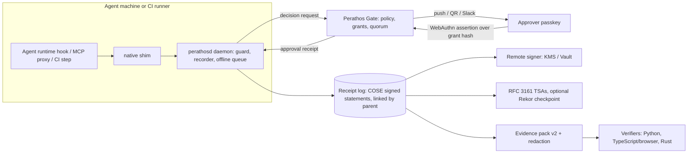

# Perathos 2.0 roadmap

Status: **draft for approval**, written 2026-11-10. Nothing in this document is built
yet unless it says so. It replaces no existing spec.

Perathos today records what an agent did (signed, chained, timestamped receipts),
stops destructive commands unless a signed precondition exists, and lets a person
approve an irreversible action with a passkey through Perathos Gate. This roadmap
says what to build next, in what order, and how we will know it worked.

## 1. Where we start (measured 2026-11-10)

| Measure | Value today | Source |
|---|---|---|
| Client release | `perathos` 1.3.1 on PyPI | release v1.3.1 |
| Hook latency | about 0.35 s per call on Windows (Python start-up) | earlier measurement, to be re-measured per OS |
| Guard bypass corpus | 41 cases, 41 blocked (148 of 148 since item 1.5 landed; 492 of 492 after the coverage fix) | test suite |
| Independent verifiers | 2 (Python CLI, browser JavaScript) for receipt v1 | repo |
| Gate server tests | 29 | `perathos-gate` |
| Hosted Gate | 1 organisation, 1 approver, 1 real phone approval verified | `gate verify` on the live receipt |
| GitHub stars | 0 (both repos) | GitHub API |
| PyPI downloads | 655 last week as reported by pypistats; mostly mirrors and CI, not users | pypistats |
| Design partners | 0 written | outreach log |

Known limits we already publish: the guard matches patterns and is not a sandbox
(environment-variable indirection and downloaded scripts got past it when this
was measured; since item 1.5 their common forms are flagged as "unresolvable"
and need a precondition or approval, and a deliberately hostile agent can still
disguise a command in other ways, listed in the README); with the
default local key the agent could read the signing key; a period with hooks
switched off is invisible in the log. In addition, `docs/THREAT_MODEL.md` still
describes the older proof-bundle layer, not the recorder, guard or Gate.

## 2. Landscape check, and what it changes

Checked against primary sources on 2026-11-10 unless marked "unverified".

### 2.1 Corrections to our own assumptions

1. **The EU AI Act high-risk dates moved.** Regulation (EU) 2026/1744 (in force
   27 July 2026) delays the high-risk obligations, which include Article 12
   record-keeping, Article 14 human oversight, Article 19 logs and Article 26
   deployer duties, to **2 December 2027** for Annex III systems and 2 August 2028
   for Annex I products. We must stop saying "August 2026".
   <https://eur-lex.europa.eu/eli/reg/2026/1744/oj/eng>
2. **Signed receipts are no longer a differentiator.** asqav, the agent-receipts
   family and about fifteen IETF individual drafts all sign agent actions. What
   nobody else was found to do: bind the approver's WebAuthn assertion to the
   action hash inside a receipt that verifies offline, and enforce a signed,
   verified precondition in the guard.
3. **A standard for our Gate is forming.** The OpenID AuthZEN working group
   published two drafts on 15 June 2026: AARP (Access Request and Approval
   Profile) and COAZ (MCP tool authorization). AARP is the closest standard to
   Perathos Gate.
   <https://openid.net/openid-foundation-advances-authorization-for-the-agent-era-with-new-authzen-working-group-drafts/>
4. **AIUC-1 made human approval a core control.** D003.4 (human-approval
   workflows) became core in the 15 October 2026 release; D003.3 is the tool-call
   log and D003.5 log review. Next release 15 January 2027.
   <https://standard.aiuc-1.com/changelog/>
5. **OpenTelemetry GenAI is still unstable.** Every `gen_ai.*` convention is in
   Development and there is no convention for approvals. We can export spans, but
   "every receipt is an OpenTelemetry span" has to mean a pinned, versioned
   mapping, not conformance to a stable standard.
   <https://github.com/open-telemetry/semantic-conventions-genai>
6. **Synced passkeys do not prove hardware.** Apple and Google synced passkeys
   give no usable attestation. Receipts should record the authenticator's AAGUID
   and backup flags, and we must not claim device binding by default.

### 2.2 Standards we will build on

| Area | Status | What we do with it |
|---|---|---|
| IETF SCITT | Architecture is RFC 9943, COSE Receipts RFC 9942 (June 2026); SCRAPI in the RFC Editor queue. No agent profile adopted; several competing individual drafts. No free public instance found. | Emit SCITT-shaped signed statements. Do not run a public log. |
| COSE | RFC 9052; Hash Envelope RFC 9995 and RFC 3161 timestamp header RFC 9921 (both 2026); CWT claims in headers RFC 9597; ML-DSA RFC 9964 | Our hash-plus-timestamp design maps directly onto 9995 + 9921. |
| Sigstore | Rekor v2 is GA but the public instance reportedly keeps v1 as default; only `hashedrekord` and `dsse` entries; no written policy on non-software entries found (unverified) | Optional anchoring of session checkpoints only, never per action. |
| in-toto | Attestation framework v1.2.0; no predicate for agent actions | Offer a DSSE export with our own predicate type. |
| MCP | Spec 2026-07-28: stateless, OAuth 2.1 resource server, URL-mode elicitation; tool annotations are untrusted hints | Use URL elicitation as the native "go approve this" signal in the proxy. |
| A2A | v1.0: optional JWS-signed agent cards, `AUTH_REQUIRED` task state | Map a Gate hold to `AUTH_REQUIRED`. |
| Agent identity | WIMSE `draft-ietf-wimse-aims-01`; OAuth transaction tokens near IESG; nothing final | Carry an optional workload identity claim. Do not build an identity system. |
| Policy | Cedar 4.14 is the de facto agent-policy language (AWS AgentCore Policy GA March 2026); OPA 1.22 | Cedar for Gate policy, behind an AuthZEN-shaped decision call. |
| Post-quantum | NIST IR 8547 reportedly retires Ed25519-class signatures after 2030 (unverified at source); ML-DSA available in pyca/cryptography 48 | Make v2 algorithm-agile; hybrid signatures as an option, not a default. |
| Selective disclosure | SD-JWT is RFC 9901; SD-CWT in AD evaluation | Salted-hash redaction in the SD-CWT style. |
| Logging standards | prEN 18229-1 (EU logging) and ISO/IEC DIS 24970 still drafts | Track; align field names when they settle. |

### 2.3 Runtimes and pipelines

Every major runtime now has a pre-tool hook that can block: Claude Code, Cursor,
Codex CLI, Gemini CLI, OpenHands, LangGraph, CrewAI, OpenAI Agents SDK, Vercel AI
SDK and Mastra. The coding CLIs fail open by default and their "ask" mode is
unreliable, so our adapters must deny, then poll the Gate, and set the fail-closed
option where one exists (`onFailure: "block"` in Claude Code, `failClosed` in
Cursor). Codex documents its hook as "not a complete enforcement boundary".

Cheapest real pipeline gates: a GitHub deployment protection rule, a Terraform
run task, and Airflow's `ApprovalOperator` (3.1+). GitHub Copilot code review can
now approve pull requests in preview, which means "required review" may be met
without a person; that is a concrete reason for a passkey-bound approval.

### 2.4 Incidents we can cite honestly

Replit/SaaStr database deletion (July 2025); DataTalks.Club `terraform destroy`
by Claude Code (26 February 2026); PocketOS production database and backups
deleted through a Railway token by a Cursor agent (April 2026). Most accounts
rest on the affected party's own statements, and we say so when citing them.

## 3. The thesis

Recording is table stakes and the platforms are absorbing it. The defensible
position is narrower:

> **Policy decides, a person authorises with a key only they hold, and the
> evidence verifies offline in a standards-shaped format, across a whole
> pipeline.**

Three things carry that: (1) the approval receipt, where a passkey signature is
bound to the exact action or grant; (2) the signed precondition, which no other
project was found to have; (3) being the reference implementation of whichever
receipt and approval profiles the standards bodies adopt.

## 4. Target architecture

### 4.1 Receipt v2 (`perathos.receipt/v2`)

* **Envelope:** COSE_Sign1 with the payload hashed per RFC 9995, issuer and
  subject in CWT claims (RFC 9597), timestamp tokens in the RFC 9921 header.
  This makes each sealed checkpoint a SCITT signed statement.
* **Body:** the v1 fields, plus `parent` (session id, sequence and hash of the
  receipt that caused this one), `trace_id`/`span_id` for correlation, an
  optional workload identity, and a `grant` reference when an approval or
  standing grant allowed the action.
* **Provenance graph:** `parent` links cross sessions, machines and vendors.
  A sub-agent's first receipt points at the orchestrator's spawn receipt; a CI
  job's first receipt points at the receipt that pushed the commit.
* **Algorithm agility:** Ed25519 by default; ML-DSA-65 or a hybrid as an option.
* **Exports, not rewrites:** DSSE/in-toto statement and OpenTelemetry span
  (semantic-convention version pinned) are derived views of the same receipt.
* **Migration:** v1 logs stay valid; verifiers accept both; a v1 log can be
  continued in v2 with a documented bridge receipt.

### 4.2 Approval v2 (`perathos.gate/v2`)

One primitive, the **grant**, covers every case:

| Grant | Covers | Ends when |
|---|---|---|
| Action | one exact action (args hash), as today | used once or expired |
| Plan | a set of action hashes approved together | all used, expired or revoked |
| Standing | a scope (tool, target pattern), with a budget (count or amount) and a time window | budget spent, window closed or revoked |
| Break-glass | proceeds at once, flagged for mandatory review | reviewed |

Each grant is signed by one or more passkeys (m-of-n by policy) over the hash of
the grant, and countersigned by the Gate. Revocations are signed and listed. The
receipt records the authenticator's AAGUID and backup flags. Field names follow
AuthZEN AARP where it has them.

### 4.3 Policy

Cedar policies in the Gate decide one of: allow, deny, or require a grant of a
given type with a given quorum. The guard's pattern rules become the default
policy set. Commands the guard cannot resolve (environment-variable indirection,
piping a download into a shell) are classified "unresolvable" and need a grant.
That narrows the two published bypass classes without claiming a sandbox.

### 4.4 Daemon

Measure first. If start-up is the whole cost, as expected, the fix is a small
native shim (Rust) that the hook runs, talking over a local socket or named pipe
to a resident `perathosd`. Target: 20 ms p95 per hook on Windows, macOS and
Linux. Receipts queue on disk when the network or the Gate is down; a gated
action still fails closed when no grant can be fetched.

### 4.5 What we will not build

* A public transparency log, or an identity or key-management service. Anchor to
  existing ones; use the customer's KMS.
* SSO/SCIM, a Kubernetes admission webhook, a Go verifier, confidential-computing
  attestation, Paystack billing: each waits for a named customer asking for it.
* Session replay. It conflicts with the content-free design.

## 5. Plan

Dates assume approval this week. Each slice ships in small pull requests with
tests, docs and a changelog entry; releases by tag only.

### Slice 1: days 1 to 30 (to 10 December; partner gate on 4 December)

Goal: a design partner can go from a clean machine to a verified phone approval
in under an hour, and on a real pipeline.

| # | Deliverable | Done when |
|---|---|---|
| 1.1 | `gate request` prints a QR code; Gate sends Web Push and Slack notifications | a first-time approver completes an approval without retyping a link |
| 1.2 | GitHub Action gate (deployment protection rule plus a step action) | a real workflow in a public demo repository blocks until a passkey approval, and the receipt verifies |
| 1.3 | Hook adapters for Codex CLI and Gemini CLI, fail-closed where the tool allows | each tested against the real tool, or stated as replay-only |
| 1.4 | Draft specs `RECEIPT_V2.md` and `GATE_V2.md`, and conformance vectors v0 | merged as drafts; vectors run against both v1 verifiers for the shared parts |
| 1.5 | Guard: "unresolvable" class, corpus grown past 60 cases | corpus runs in CI at zero bypasses |
| 1.6 | `THREAT_MODEL.md` rewritten for recorder, guard and Gate; disclosure policy | published |
| 1.7 | Railway auto-deploy with a pre-deploy database backup | a merge to `main` deploys; restore drill done once |
| 1.8 | One-page "why this is different" and an onboarding guide timed on a clean machine | timed run recorded |

### Slice 2: days 31 to 60

Goal: protocol v2 and grants exist and are verifiable by two independent
implementations.

| # | Deliverable | Done when |
|---|---|---|
| 2.1 | Receipt v2 in the Python client and the TypeScript/browser verifier | both pass the same conformance suite; v1 logs still verify |
| 2.2 | `parent` links and `perathos graph` | a production change in the demo repository can be walked back to the approving person |
| 2.3 | Gate: Cedar policy, plan and standing grants, m-of-n, revocation | software-passkey end-to-end tests in CI; hosted Gate migrated with a backup and zero data loss |
| 2.4 | Terraform/OpenTofu plan gate (run task and local wrapper) | a real plan with a destroy is held and released |
| 2.5 | DSSE/in-toto export, optional Rekor checkpoint anchoring, second TSA | exported statement verifies with stock tooling |
| 2.6 | MCP proxy: batch arrays handled, URL elicitation for approvals | tested with a real MCP client |

### Slice 3: days 61 to 90

Goal: fast, auditable, sellable.

| # | Deliverable | Done when |
|---|---|---|
| 3.1 | Rust shim and daemon with offline queue; Rust verifier on the same suite | 20 ms p95 measured on three operating systems in CI |
| 3.2 | Evidence pack v2: mapping to AIUC-1, EU AI Act Articles 12, 14, 19 and 26, ISO/IEC 42001 and SOC 2 with control text quoted from primary sources; redaction with proofs | a redacted pack verifies; each partial control is labelled partial |
| 3.3 | Hosted auditor viewer (static, no install) | opens a pack offline in a browser |
| 3.4 | Gate admin surface: approvers, roles, policies, audit log, key rotation | usable without the CLI |
| 3.5 | Billing with Stripe, only if a partner has agreed a price | one paid or signed pilot |
| 3.6 | Airflow approval operator | runs in a real DAG |
| 3.7 | Standards: comments to AuthZEN AARP, contact with the SCITT agent-receipt draft authors, AICPA Trust Services Criteria comment (due 15 January 2027) | drafts prepared; Tamuka submits |

### Measured targets

| Measure | Today | Day 30 | Day 60 | Day 90 |
|---|---|---|---|---|
| Hook latency p95, slowest OS | about 350 ms | measured per OS | measured | 20 ms |
| Bypass corpus (all blocked) | 41 (148 once item 1.5 landed, now 492) | 60 | 80 | 100 |
| Verifiers passing one suite | 2 (v1) | 2 (v1 vectors) | 2 (v2) | 3 (v2) |
| Integrations tested against the real tool | 0 run live | 3 | 5 | 7 |
| Clean-machine onboarding | untimed | under 60 min | under 30 min | under 15 min |
| Written design partners | 0 | 1 | 2 | 3 |

## 6. Risks

* **Scope.** The full ambition is several quarters of work for a team. Ninety
  days delivers the spine; section 4.5 lists what waits.
* **Standards churn.** Agent receipt profiles and AARP are drafts. We version
  everything and keep exports as derived views, so a change costs a mapper, not
  a migration.
* **Platforms absorb the guard.** Likely. The guard is the on-ramp; the grant
  and the evidence are the product.
* **Demand is unproven.** Zero stars and zero partners today. Slice 1 is ordered
  to produce demos and onboarding before deeper protocol work for that reason.
* **Hosted Gate is a single small deployment.** No status page, no on-call. We
  say so to partners until that changes.

## 7. Decisions needed

1. Approve this order, or move protocol v2 ahead of the partner-facing work in
   slice 1.
2. Rust for the shim and daemon (recommended: one codebase also gives the third
   verifier) or Go.
3. Cedar as the only policy language at first (recommended) or Cedar and Rego.
4. Whether billing waits for a signed partner (recommended) or ships on a date.
